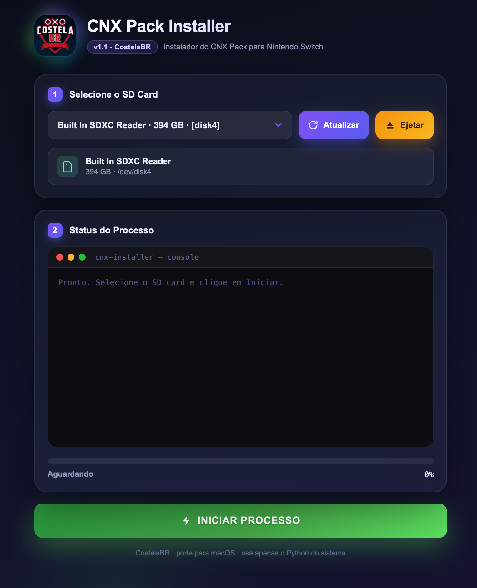
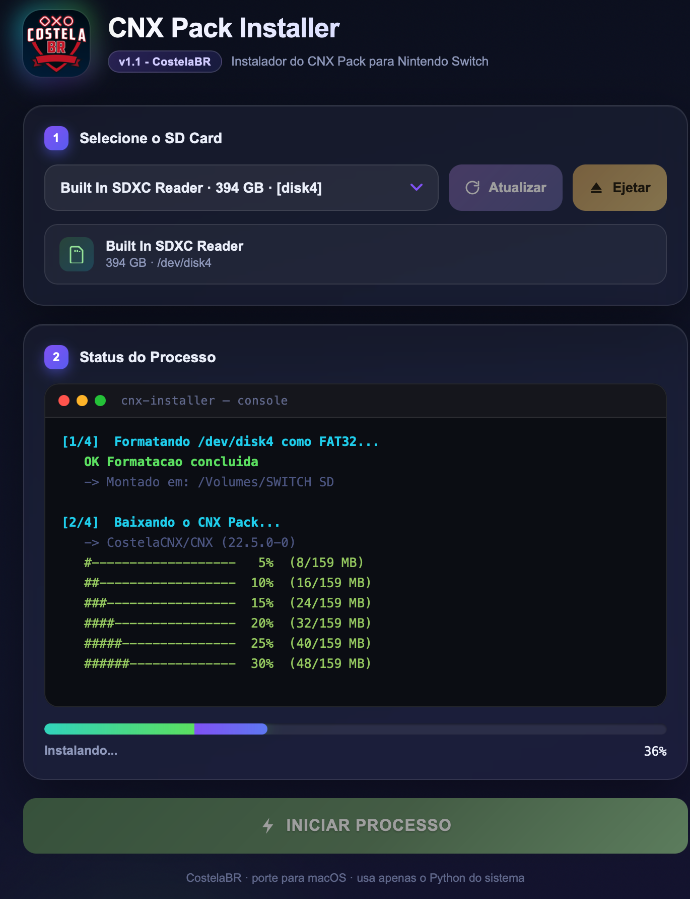
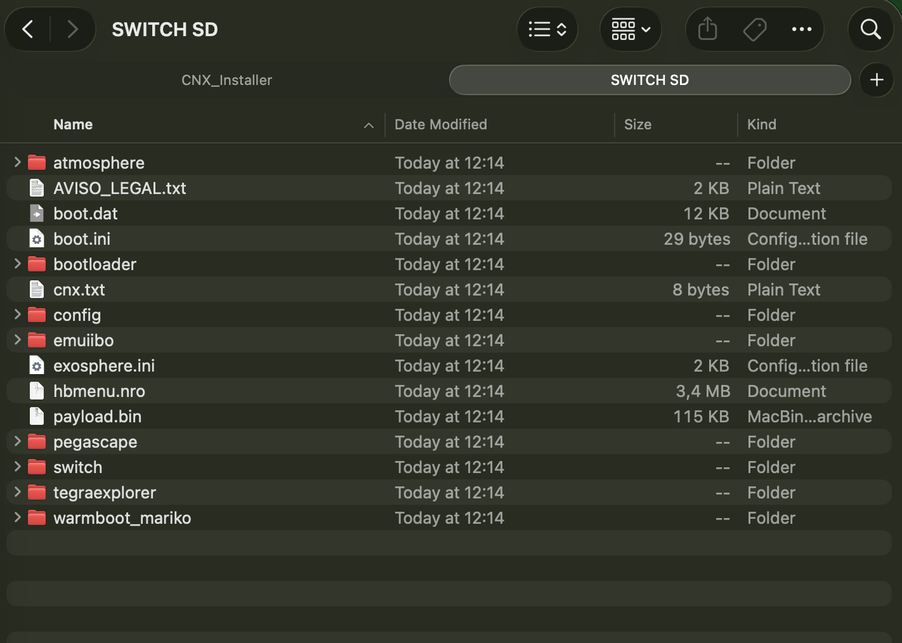

# CNX Pack Installer — macOS

macOS port of **CNX_Installer_v1.1** by CostelaBR.  
Installs the CNX Pack (Atmosphère CFW) onto a Nintendo Switch SD card.

---

## Screenshots

| Idle | Running | Done |
|---|---|---|
|  |  |  |

---

## What it does

1. Lists your external/removable disks (never touches the internal drive)
2. Formats the selected SD card as **FAT32** (required by Switch CFW)
3. Downloads the latest CNX Pack from the [CostelaCNX/CNX](https://github.com/CostelaCNX/CNX) GitHub release (~160 MB)
4. Extracts all files to the SD card
5. Extracts a secondary package hidden inside `bootloader/bootlogo_atmo_sys.bmp`

---

## Requirements

- **macOS 10.15 or later** (Catalina+)
- **Internet connection** (downloads ~160 MB from GitHub)
- An SD card reader / the SD card connected

No Python packages to install — uses the system Python at `/usr/bin/python3` which has Tk/tkinter built in.

---

## How to run

### Option A — Double-click (easiest)

1. Right-click **`CNX_Installer.app`** → **Open**
2. Click **Open** in the security dialog (required because the app is unsigned)
3. Select your SD card from the dropdown and click **INICIAR PROCESSO**

> **Why right-click → Open?**  
> macOS Gatekeeper blocks unsigned apps on first launch. Right-click → Open bypasses that one time. After that you can double-click normally.

### Option B — Terminal

```bash
/usr/bin/python3 ~/Downloads/CNX_Installer/CNX_Installer_mac.py
```

> Do **not** use `python3` from Homebrew — Homebrew Python does not include tkinter.  
> Always use the full path `/usr/bin/python3`.

---

## Troubleshooting

| Problem | Fix |
|---|---|
| "App is damaged" / won't open | Run in Terminal: `xattr -cr ~/Downloads/CNX_Installer/CNX_Installer.app` then try again |
| SD card not listed | Reconnect the SD card, then click **Atualizar** |
| Format fails | Open Disk Utility, eject/unmount the SD card first, then retry |
| Download fails | Check your internet connection; the app will auto-retry with the backup repo |

---

## Files

```
macos/
├── CNX_Installer.app/        ← double-click this
│   └── Contents/
│       ├── MacOS/
│       │   └── CNX_Installer (shell launcher → calls system Python)
│       ├── Resources/
│       │   └── CNX_Installer_mac.py
│       └── Info.plist
├── CNX_Installer_mac.py      ← standalone script (same thing)
├── screenshots/              ← images used in this README
└── README.md
```
